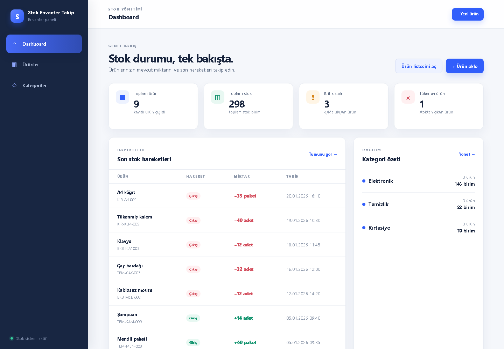
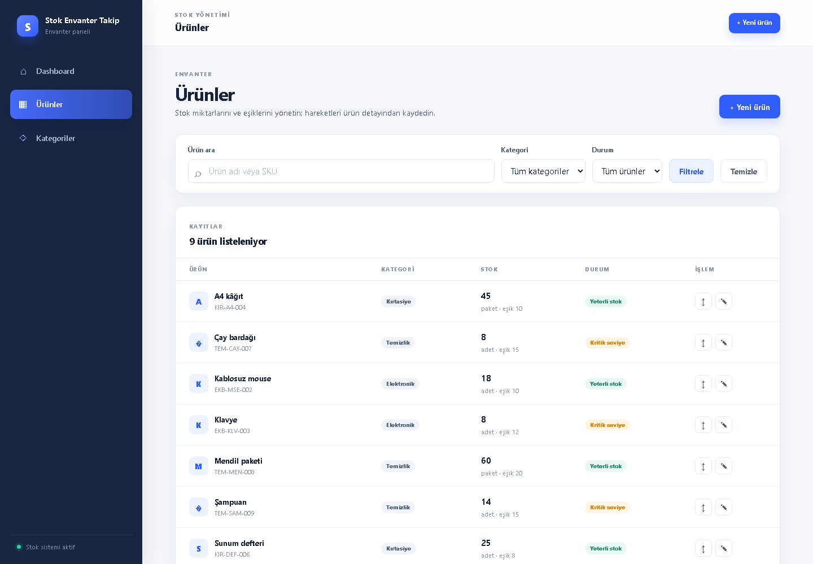

# Stok / Envanter Takip

PHP 8 ve MySQL ile geliştirilen, küçük ekiplerin ürün, kategori ve stok hareketlerini izlemesini amaçlayan web uygulaması.

## Problem

Excel dosyaları veya kâğıt listelerle stok takibi, ürün adı, kategori, mevcut miktar ve geçmiş hareketlerin ayrı ayrı kontrol edilmesini gerektirir. Bu proje; ürünleri tek listede toplar, kritik stok eşiğini otomatik işaretler ve her giriş/çıkışı zaman damgalı bir hareket kaydıyla ilişkilendirir.

## Özellikler

- Dashboard özeti: toplam ürün, toplam stok birimi, kritik seviyedeki ürün, tükenen ürün ve kategori dağılımı
- Kategori oluşturma ve kategori bazlı ürün listeleme
- SKU, ad, kategori, birim, açıklama ve kritik stok eşiği ile ürün ekleme/güncelleme
- Ürün adı veya SKU arama; kategori ve stok durumuna göre filtreleme
- Stok giriş/çıkış formu, son hareket geçmişi ve yetersiz stok kontrolü
- Stok değişimlerinin işlem (transaction) içinde ve ürün satırı kilitlenerek kaydedilmesi
- PDO prepared statements ve kapalı PDO emülasyonu
- CSRF token koruması ve tüm dinamik çıktılarda HTML escaping
- Başlangıç verileri, Docker Compose kurulumu ve manuel XAMPP kurulumu

> Bu sürümde kullanıcı girişi bulunmaz. İnternete açık bir üretim ortamında kullanılmadan önce kimlik doğrulama, yetkilendirme ve HTTPS zorunlu olarak eklenmelidir.

## Ekran Görüntüleri

Uygulamanın demo verileriyle çalışan arayüzünden alınan ekran görüntüleri:

| Dashboard | Ürünler ve Filtreleme |
| --- | --- |
|  |  |

## Teknolojiler

- PHP 8.0+
- MySQL 8 / MariaDB 10.6+
- PDO ve prepared statements
- HTML5, CSS3 ve Vanilla JavaScript
- Docker / Docker Compose
- Bağımlılıksız PHP test koşucusu

## Mimari

Proje, harici framework bağımlılığı olmayan hafif bir MVC benzeri düzen ve constructor injection kullanır:

```text
stock-inventory/
├── public/                 # Tek giriş noktası ve statik dosyalar
│   ├── assets/css/
│   ├── assets/js/
│   ├── index.php
│   └── router.php
├── src/
│   ├── Controller/         # İstekleri iş alanına yönlendirir
│   ├── Exception/          # Alan ve HTTP hataları
│   ├── Http/               # Request, Response, Router, CSRF
│   ├── Repository/         # PDO/SQL sorguları
│   ├── Service/            # Doğrulama ve iş kuralları
│   ├── Validation/         # Girdi doğrulayıcıları
│   ├── Views/              # HTML şablonları
│   ├── Application.php
│   ├── Database.php
│   ├── View.php
│   └── helpers.php
├── config/                 # config.php yereldir ve Git'e eklenmez
├── database/               # schema.sql ve seed.sql
├── tests/                  # Yardımcı ve uçtan uca smoke testleri
├── docker-compose.yml
└── Dockerfile
```

### Ana akışlar

1. `public/index.php` isteği `Application` sınıfına aktarır.
2. `Router`, HTTP yöntemi ve URL eşleşmesine göre controller çağırır.
3. Controller girişleri doğrular; service iş kurallarını uygular.
4. Repository'ler tüm SQL işlemlerinde PDO prepared statement kullanır.
5. Stok giriş/çıkışı transaction ve `SELECT ... FOR UPDATE` ile eşzamanlı işlemlere karşı korunur.
6. View katmanı dinamik değerleri `e()` yardımcı fonksiyonuyla escape eder.

## Kurulum

### Docker Compose (önerilen)

Gereksinimler: Docker Engine/Desktop ve Docker Compose v2.

Proje dizininde tek komutla başlatın:

```bash
docker compose up --build
```

Uygulama `http://localhost:8080`, API özeti ise `http://localhost:8080/api/summary` adresinde açılır. İlk açılışta MySQL kapsayıcısı `database/schema.sql` ve `database/seed.sql` dosyalarını otomatik çalıştırır.

İsteğe bağlı ayarlar için `.env.example` dosyasını `.env` olarak kopyalayın:

```bash
cp .env.example .env
```

`.env` Git'e eklenmez. Varsayılan geliştirme parolaları yalnızca yerel kullanım içindir.

Konteynerleri ve demo veritabanını tamamen sıfırlamak için:

```bash
docker compose down -v
docker compose up --build
```

### XAMPP / Apache

1. XAMPP üzerinden Apache ve MySQL'i başlatın.
2. MySQL'de veritabanını ve demo verilerini yükleyin:

   ```bash
   mysql -u root -p < database/schema.sql
   mysql -u root -p < database/seed.sql
   ```

   XAMPP içindeki phpMyAdmin ile de `database/schema.sql` ve ardından `database/seed.sql` dosyalarını içe aktarabilirsiniz.

3. Yerel ayarları hazırlayın:

   ```powershell
   Copy-Item config/config.example.php config/config.php
   ```

   `config/config.php` içindeki kullanıcı adı ve parolayı XAMPP/MySQL ayarlarınıza göre düzenleyin. Bu dosya `.gitignore` ile Git'e eklenir.

4. Apache `DocumentRoot` değerini proje içindeki `public/` klasörüne ayarlayın ve ilgili `<Directory>` bloğunda `AllowOverride All` seçeneğini etkinleştirin. Örnek: `DocumentRoot "C:/xampp/htdocs/stock-inventory/public"`. Böylece `public/.htaccess` yönlendirmesi kullanılabilir.
5. Bu ayarla tarayıcıdan `http://localhost/` adresini açın. `DocumentRoot` değiştirilemiyorsa Apache sanal host/vhost tanımlayarak aynı şekilde `public/` klasörünü kök olarak yayınlayın; uygulama kök dizinde çalışacak şekilde yönlendirilmiştir.

### PHP yerleşik sunucusu

PHP 8.0+ ve PDO MySQL eklentisi kuruluysa XAMPP olmadan da çalıştırılabilir:

```bash
php -S 127.0.0.1:8000 -t public public/router.php
```

Ardından `http://127.0.0.1:8000` adresini açın.

## Yapılandırma

`config/config.example.php` örnek dosyasıdır. Uygulama varsa yerel `config/config.php` dosyasını, yoksa güvenli örnek dosyayı okur. Docker ortamında değerler `.env`/Compose değişkenleriyle geçersiz kılınabilir.

| Değişken | Açıklama | Yerel varsayılan |
| --- | --- | --- |
| `APP_ENV` | Ortam (`development`, `production`) | `development` |
| `APP_DEBUG` | Hata ayrıntılarını göster | `1` |
| `APP_NAME` | Uygulama adı | `Stok Envanter Takip` |
| `DB_HOST` | MySQL sunucusu | `127.0.0.1` |
| `DB_PORT` | MySQL portu | `3306` |
| `DB_DATABASE` | Veritabanı adı | `stock_inventory` |
| `DB_USER` | MySQL kullanıcısı | `root` |
| `DB_PASSWORD` | MySQL parolası | boş |

## Veritabanı

- `database/schema.sql`: `categories`, `products` ve `stock_movements` tablolarını oluşturur.
- `database/seed.sql`: güvenli, sentetik demo kategorileri, ürünleri ve tutarlı stok hareketlerini ekler.
- `products.quantity` her zaman hareketlerle eşitlenmiş güncel toplamı tutar.
- `stock_movements.type` değerleri `in` veya `out` olur; miktar alanı daima pozitiftir.

Veritabanını PHP yönetim aracı üzerinden değiştirmek yerine şema dosyalarını güncelleyin. Örnek geliştirme komutu:

```bash
mysql -u root -p < database/schema.sql
mysql -u root -p < database/seed.sql
```

## Test ve kontrol

Yerel PHP testleri veritabanına bağlanmadan çalışır:

```bash
php tests/run.php
```

Testler; CSRF token doğrulamasını, ürün/kategori girdi doğrulamasını ve router eşleştirmesini kapsar.

Uygulama ve veritabanı çalışırken HTTP smoke testi:

```bash
php tests/functional/http_smoke.php http://localhost:8080
```

Tüm PHP dosyalarının lint kontrolü (PowerShell):

```powershell
Get-ChildItem -Recurse -Filter *.php | ForEach-Object { php -l $_.FullName }
```

Bash alternatifi:

```bash
find . -name '*.php' -print0 | xargs -0 -n1 php -l
```

## API

`GET /api/summary` isteği dashboard için gerekli özet verileri JSON olarak döndürür:

```json
{
  "summary": {
    "total_products": 9,
    "total_units": 298,
    "critical_stock": 3,
    "out_of_stock": 1,
    "total_categories": 3
  },
  "recent_movements": []
}
```

Bu endpoint oturum açma gerektirmez ve hassas kişisel veri içermez.

## Güvenlik

- Tüm SQL değerleri prepared statement ile gönderilir; kullanıcı girdisi SQL'e birleştirilmez.
- PDO emülasyonu kapatılır (`ATTR_EMULATE_PREPARES => false`).
- Şablonlardaki t dinamik çıktılar `htmlspecialchars(..., ENT_QUOTES | ENT_SUBSTITUTE, 'UTF-8')` ile escape edilir.
- Tüm HTML form POST işlemleri oturum tabanlı CSRF token ve sabit zamanlı `hash_equals()` ile korunur.
- Çerezler HttpOnly ve SameSite=Lax olarak ayarlanır; HTTPS algılanırsa Secure özniteliği eklenir.
- Hata mesajları production ortamında kullanıcıya ayrıntı gösterilmez.
- Güvenlik başlıkları `X-Content-Type-Options`, `X-Frame-Options`, `Referrer-Policy` ve CSP olarak uygulanır.
- Üretim öncesi kimlik doğrulama, rol bazlı yetkilendirme, HTTPS, rate limiting ve merkezi loglama eklenmelidir.

Ayrıntılar için [SECURITY.md](SECURITY.md) dosyasına bakın.

## Lisans

[MIT](LICENSE) lisansı ile yayımlanmıştır.
